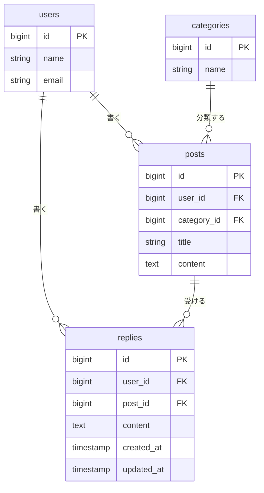

> この設計書は、この機能を実装した時点の記録です。このあとは更新していません。

# リプライ機能 設計書

Issue: [#1 リプライ機能を追加する](https://github.com/phatnguyen-1998/post-app-practice/issues/1)

## 概要

ポストを読んだ人が、その場で一言返せるようにする。今は読むだけで、返す手段がない。

- ポストを1件開く画面（詳細画面）を新しく作り、そこにそのポストへのリプライを一覧で出す。
- 詳細画面の下に入力欄を置き、本文を送るとリプライが増える。
- リプライを消せるのは書いた本人だけ。判定は `PostPolicy` と同じやり方（`$user->id === $reply->user_id`）で、`ReplyPolicy` に置く。
- 親のポストを消したら、そのリプライも一緒に消える。
- リプライに返信する（入れ子）、編集する、件数を一覧に出す、は今回やらない。

## 受け入れ条件

Issue #1 の完成の条件そのまま。ブラウザの操作で確かめる。

1. ポストを1件開くと、そのポストとリプライの一覧が見える。
2. 本文を入れてリプライを送ると、一覧に増える。
3. 本文が空のままだと、エラーが表示されてリプライは増えない。
4. 自分のリプライは消せて、他人のリプライは消せない。

## 変えないもの

- タイムライン（`/posts`）の一覧・編集・削除の動き。一覧には詳細画面へのリンク（タイトル・本文と「返信」）を足すだけで、表示するデータも取得のしかた（`with(['user', 'category'])`）も変えない。
- `PostPolicy` の判定（本人だけが update / delete できる）。
- 既存のルート名と URL（`posts.index` / `posts.edit` / `posts.update` / `posts.destroy`）。
- `posts` / `categories` / `users` テーブルの構造。
- ポストの入力チェック（`PostController@update` の `title` / `content` / `category_id`）。
- 検証用アカウント `usera@example.com` / `userb@example.com` のメールとパスワード。

## 増えるテーブル

`replies` を1つ足す。

| カラム | 型 | 制約 | 説明 |
|---|---|---|---|
| id | bigint unsigned | PK | |
| user_id | bigint unsigned | FK → users.id、`cascadeOnDelete` | リプライを書いた人 |
| post_id | bigint unsigned | FK → posts.id、`cascadeOnDelete` | 返信先のポスト |
| content | text | NOT NULL | 本文（280字まで。上限は入力チェックで守る） |
| created_at / updated_at | timestamp | | |

- 新しいのは `replies` だけ。ほかのテーブルは図に出しているが変えない。
- ユーザーを消したときも、そのユーザーのリプライは消える（`user_id` の `cascadeOnDelete`）。

## 増える画面

| 画面 | URL・ルート名 | 内容 |
|---|---|---|
| ポスト詳細 | `GET /posts/{post}`（`posts.show`） | ポスト本体、リプライ一覧（古い順）、リプライ入力欄 |

操作は次の2つ。どちらも詳細画面から行い、終わったら詳細画面に戻る。画面は増えない。

| 操作 | URL・ルート名 | 結果 |
|---|---|---|
| リプライを送る | `POST /posts/{post}/replies`（`replies.store`） | 保存して詳細画面へ戻る。入力エラーのときは、詳細画面にエラーを出す |
| リプライを消す | `DELETE /replies/{reply}`（`replies.destroy`） | 削除して、そのポストの詳細画面へ戻る |

詳細画面の構成（上から）:

1. ヘッダー（一覧と同じ。ブランド、ログイン中のユーザー、ログアウト）
2. ポスト本体（投稿者、日時、トピック、タイトル、本文）
3. 「リプライ（n）」の見出しと、リプライの一覧。0件のときは「まだリプライがありません。」
4. リプライ入力欄と「返信する」ボタン

- 「削除」ボタンは、自分のリプライにだけ出す（`@can('delete', $reply)`）。
- 3つのルートはすべて `auth` ミドルウェアのグループに入れる。ログインしていなければログイン画面へ送る。
- 見た目は既存の画面に合わせ、ビューの中に直接書いた CSS だけで組む。ビルドした CSS / JavaScript は使わない。

## 入力チェックとメッセージ一覧

### 入力チェック（リプライを送る）

| 項目 | 必須 | 文字数 | 形式 |
|---|---|---|---|
| content（本文） | ○ | 280字まで | 文字列 |

- 入力欄に `required` 属性は付けない。付けるとブラウザが先に止めて、サーバー側のエラー表示が確かめられないため。
- 検証は `PostController` と同じく、コントローラー内の `$request->validate()` で行う。

### メッセージ一覧

| 場面 | 出るもの | 文言 |
|---|---|---|
| 本文が空 | 入力欄の下にエラー | `The content field is required.` |
| 本文が281字以上 | 入力欄の下にエラー | `The content field must not be greater than 280 characters.` |
| 他人のリプライを消そうとした | HTTP 403 | Laravel の標準の 403 画面 |
| 存在しないポスト・リプライ | HTTP 404 | Laravel の標準の 404 画面 |
| ログインしていない | ログイン画面へリダイレクト | ― |

- 文言は、アプリのロケールが `en` のままなので Laravel 標準の英語。ポスト編集のタイトルなどと同じ扱いにしている。日本語にするかは別の課題。

## テスト観点

`tests/Feature/ReplyTest.php`（Feature テスト）。状態: ○ = 作成済み、△ = 未作成（いまは全項目が作成済み）。

| # | 観点 | 期待する結果 | 状態 |
|---|---|---|---|
| 1 | ログイン済みで詳細画面を開く | 200。ポストのタイトルとリプライの本文が見える | ○ |
| 2 | 未ログインで詳細画面を開く | `/login` へリダイレクト | ○ |
| 3 | 本文を入れてリプライを送る | 詳細画面へ戻る。`replies` に user_id・post_id・content が入る | ○ |
| 4 | 本文が空で送る | 詳細画面へ戻り、`content` のエラーがセッションに入る。`replies` は0件のまま | ○ |
| 5 | 自分のリプライを消す | 詳細画面へ戻る。リプライが消える | ○ |
| 6 | 他人のリプライを消す | 403。リプライは残る | ○ |
| 7 | 削除ボタンの出し分け | 自分のリプライの削除 URL は出て、他人のは出ない | ○ |
| 8 | ポストを消す | そのリプライも一緒に消える | ○ |
| 9 | 本文が280字ちょうど | 保存できる | ○ |
| 10 | 本文が281字 | エラーになり、保存されない | ○ |
| 11 | 未ログインでリプライを送る・消す | `/login` へリダイレクト。`replies` は変わらない | ○ |
| 12 | 存在しないポストにリプライを送る | 404 | ○ |
| 13 | リプライが0件のポストの詳細画面 | 「まだリプライがありません。」が出る | ○ |
| 14 | 一覧画面の動きが変わらない | 一覧・編集・削除の既存の動きのまま（「返信」リンクが出る以外） | ○ |

ブラウザでの確認（受け入れ条件 1〜4）は、`migrate:fresh --seed` のあとに `usera@example.com` でログインして行う。シードには `usera` と `userb` がやりとりしているリプライを入れてあるので、「自分のは消せる・他人のは消せない」を見比べられる。
